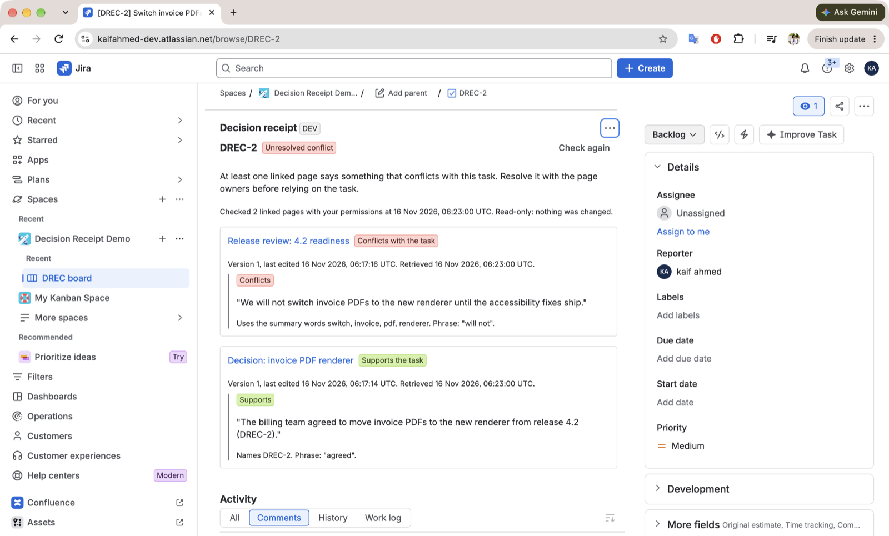

# Decision receipt

A Forge app for Jira. It adds a read-only issue panel that checks a task against the Confluence decision pages linked to it, and shows the exact sentences it relied on.

For each linked page the panel shows:

- whether the page supports the task, conflicts with it, or does not state a decision;
- the sentences it used, quoted word for word, with the reason each one was picked;
- the page version, when the page was last edited, and when the panel read it.

A conflict on any page is reported as an unresolved conflict. A page without a decision is reported as missing evidence. The panel never reports a task as approved; it shows what the pages say and leaves the decision to the reviewer.

Built for [Codegeist 2026](https://codegeist2026.devpost.com/), category Apps for Software Teams. The repository lives under Kaif Ahmed's GitHub account (`kaifahmed0341`) at his request, in place of the `sami-abdul` owner named in the original plan.



## What this first version does

- Adds a **Decision receipt** issue panel to Jira (`jira:issuePanel`, UI Kit).
- Reads the issue summary and its remote links, then reads each linked Confluence page on the same site.
- Classifies each page with a fixed rule set (below). No AI model, no outside service.
- Handles pages the viewer cannot open, deleted or archived pages, links to other sites, links without a page id, and rate limits.

## What it does not do yet

- It writes nothing: no Jira comments, no transitions, no app storage.
- It does not remember earlier checks, so it cannot yet say "this page changed since the last check". Each check shows the page version it read.
- It reads only pages linked to the issue. It does not search Confluence.
- It has no Rovo agent, MCP server or Teamwork Graph integration.
- It is deployed to the development environment only. There is no production deployment or installation link yet.

## Permission model

Every Jira and Confluence request goes out with `api.asUser()`, so it runs with the permissions of the person viewing the issue. The app never reads a page with its own identity. A reviewer sees only what they could open themselves.

When a page cannot be read, Confluence answers 404 (or 403) whether the page was deleted or the viewer lacks permission. The panel does not try to tell these apart. It shows "Not available to you" with no title, link or text from the page; the Jira link's own title and URL are left out too, because a URL can contain the page title.

Scopes in `manifest.yml`:

| Scope | Used for |
|---|---|
| `read:jira-work` | `GET /rest/api/3/issue/{key}?fields=summary` and `GET /rest/api/3/issue/{key}/remotelink` |
| `read:page:confluence` | `GET /wiki/api/v2/pages/{id}?body-format=storage` |

The app declares Jira as its required product and Confluence as optional (`app.compatibility`), which is how a Forge app placed in Jira gets to read Confluence on the same site. It must be installed in both.

## How a page is classified

The rules are in [`src/lib/classify.js`](src/lib/classify.js) and covered by tests.

1. A sentence is relevant when it names the issue key (for example `DREC-2`), when it is a status line (`Status: Deferred`), or when it contains at least 60 percent of the significant words in the issue summary, and never fewer than two.
2. A relevant sentence ending in a question mark is a question, not a decision.
3. A relevant sentence with a blocking phrase such as "will not", "rejected", "deferred" or "superseded" conflicts with the task.
4. A relevant sentence with a supporting phrase such as "approved", "agreed" or "decided to" supports the task, unless "not", "never" or "no" comes within three words before it.
5. Any other relevant sentence mentions the task without deciding anything.

A page conflicts if any sentence conflicts, supports if at least one sentence supports and none conflicts, and is missing the decision otherwise. Across pages, any conflict wins; full support needs every linked page to be read and to support the task.

These rules are deliberately simple and will miss decisions phrased in other ways. They are shown, with the matched phrase, next to every excerpt so a reviewer can check them.

## Linking a decision page

Use Jira's own **Link Confluence page** action on the issue, or any remote link whose URL is a Confluence page on the same site. The panel reads the page id from the link's `globalId` (`...&pageId=123`) or from the URL (`/wiki/spaces/KEY/pages/123/...` or `viewpage.action?pageId=123`). Short links (`/wiki/x/...`) carry no page id and are reported as unreadable.

The fixture script creates links through `POST /rest/api/3/issue/{key}/remotelink` with application type `com.atlassian.confluence`, the same shape the Jira action creates. Jira recognises these as native Confluence links and shows them under "Confluence content".

## Demonstration data

`fixtures/data.mjs` holds one Jira project (`DREC`), one Confluence space (`DRDEMO`), five pages and five issues. All of it is fictional.

| Issue | Linked pages | Expected panel result | Proof |
|---|---|---|---|
| DREC-1 Remove the v1 CSV export endpoint | one page that approves it | Evidence found on every linked page | [png](docs/proof/drec-1-supported.png) |
| DREC-2 Switch invoice PDFs to the new renderer | one page agrees, one says "will not" | Unresolved conflict | [png](docs/proof/drec-2-conflict.png) |
| DREC-3 Raise the public API rate limit to 600 requests per minute | meeting notes that discuss it without deciding | Missing evidence | [png](docs/proof/drec-3-missing.png) |
| DREC-4 Archive the legacy webhook queue | a page now in the trash | Could not check | [png](docs/proof/drec-4-deleted-page.png) |
| DREC-5 Rename the staging cluster | none | No decision pages linked | [png](docs/proof/drec-5-no-links.png) |

The screenshots were taken on 16 November 2026 from the development deployment on the author's test site. The page text refers to issue keys `DREC-1` to `DREC-4`, so run the script on a site where the `DREC` project does not exist yet.

## Setup for developers

Requirements: Node.js 22 (the Forge CLI warns on newer versions), an Atlassian account, and an Atlassian API token from <https://id.atlassian.com/manage-profile/security/api-tokens>.

```sh
npm install -g @forge/cli
npm install

# The Forge CLI reads these instead of an interactive login.
export FORGE_EMAIL=you@example.com
export FORGE_API_TOKEN=your-token
forge whoami

npm test                      # unit tests, no network
forge lint
forge deploy -e development
forge install -e development -p jira -s your-site.atlassian.net
forge install -e development -p confluence -s your-site.atlassian.net

# Create the demonstration project, space, pages, issues and links.
ATLASSIAN_SITE=https://your-site.atlassian.net \
ATLASSIAN_EMAIL=you@example.com \
ATLASSIAN_API_TOKEN=your-token \
npm run fixtures
```

The `app.id` in `manifest.yml` belongs to the author's Forge app. To deploy your own copy, run `forge register` first, which replaces it.

Then open an issue such as `DREC-2`, select the app icon under the issue summary (**View app actions**) and choose **Decision receipt**. The panel stays on the issue after that.

## Judge setup (draft)

The installation link does not exist yet; it comes with the production deployment in a later step. The steps will be:

1. Use a Jira Cloud site that also has Confluence.
2. Open the installation link, install the app in Jira, then install it in Confluence on the same site when prompted.
3. Run the fixture script above, or link any Confluence decision page to an issue with **Link Confluence page**.
4. Open the issue, choose **View app actions**, then **Decision receipt**.

## Project layout

```
manifest.yml           Forge modules, scopes and Jira/Confluence compatibility
src/resolvers/         the resolver: Jira and Confluence calls as the current user
src/lib/links.js       remote links to Confluence page ids, same-site only
src/lib/text.js        Confluence storage format to plain sentences
src/lib/classify.js    the rule set
src/lib/evidence.js    everything the reviewer reads: labels, excerpts, times
src/lib/receipt.js     puts it together, with retries on 429 and 503
src/frontend/          the UI Kit panel
fixtures/data.mjs      fictional demonstration data
scripts/fixtures.mjs   creates the demonstration data on a site
test/                  unit tests (node:test)
docs/proof/            screenshots from the running app
docs/decisions.md      choices made while building, with the alternative rejected
```

## License

MIT. See [LICENSE](LICENSE).
