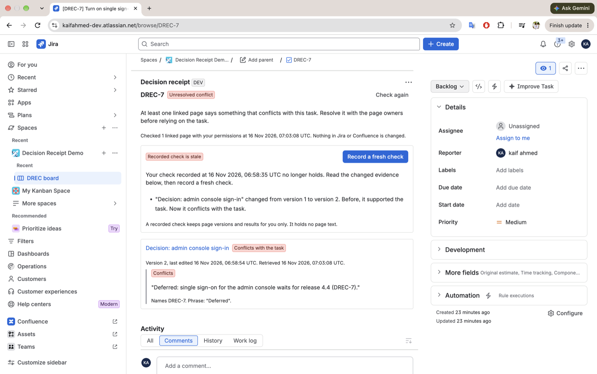

# Decision receipt

A Forge app for Jira. It adds an issue panel that checks a task against the Confluence decision pages linked to it, and shows the exact sentences it relied on.

For each linked page the panel shows:

- whether the page supports the task, conflicts with it, or does not state a decision;
- the sentences it used, quoted word for word, with the reason each one was picked;
- the page version, when the page was last edited, and when the panel read it.

A conflict on any page is reported as an unresolved conflict. A page without a decision is reported as missing evidence. The panel never reports a task as approved; it shows what the pages say and leaves the decision to the reviewer.

A reviewer can **record a check** once they have read the evidence. If a linked page is edited, added, removed or hidden after that, the panel marks the recorded check **stale** until the reviewer records a fresh one.

Built for [Codegeist 2026](https://codegeist2026.devpost.com/), category Apps for Software Teams. The repository lives under Kaif Ahmed's GitHub account (`kaifahmed0341`) at his request, in place of the `sami-abdul` owner named in the original plan.



## What it does

- Adds a **Decision receipt** issue panel to Jira (`jira:issuePanel`, UI Kit).
- Reads the issue summary and its remote links, then reads each linked Confluence page on the same site, as the viewer.
- Classifies each page with fixed text rules ([docs/rules.md](docs/rules.md)). No AI model, no outside service.
- Lets each reviewer record a check and flags it stale when the pages change.
- Reports, per page and in plain words: pages the viewer cannot open, deleted or archived pages, rate limits, interrupted requests, pages not read because of the time limit, links to other sites and links without a page id.

## What it does not do yet

- It writes nothing to Jira or Confluence. No comments, no transitions.
- It reads only pages linked to the issue. It does not search Confluence.
- Its rules miss some phrasings; see the measured limits in [docs/rules.md](docs/rules.md).
- It has no Rovo agent, MCP server or Teamwork Graph integration.
- It is deployed to the development environment only. There is no production deployment or installation link yet.

## Permission model

Every Jira and Confluence request goes out with `api.asUser()`, so it runs with the permissions of the person viewing the issue. The app never reads a page with its own identity. A reviewer sees only what they could open themselves.

When a page cannot be read, Confluence answers 404 (or 403) whether the page was deleted or the viewer lacks permission. The panel does not try to tell these apart. It shows "Not available to you" with no title, link or text from the page; the Jira link's own title and URL are left out too, because a URL can contain the page title.

A recorded check is stored in the app's Forge key-value storage under a key made of the site's cloud id, the issue id and the reviewer's account id. It holds, for each linked page, the page id, whether it could be read, its version and the verdict. It holds no page text and no titles. One reviewer's record is never read for another reviewer, so a record cannot reveal a page the second reviewer cannot open. The page ids used for stale detection stay on the server; the panel only receives a hash of them.

Tested on the live site with two accounts on 16 November 2026 (issue DREC-6, one page restricted to its owner):

| Account | Panel result | Restricted page title or text anywhere in the issue page | Proof |
|---|---|---|---|
| Demo Reviewer, no access to the page | Evidence incomplete; "Not available to you" | No | [panel](docs/proof/drec-6-reviewer-restricted.png), [Confluence refuses the page](docs/proof/drec-6-reviewer-confluence-locked.png) |
| kaif ahmed, page owner (positive control) | Unresolved conflict; quotes the restricted page | Yes | [panel](docs/proof/drec-6-owner-control.png) |

The text check for both accounts is in [docs/proof/drec-6-permission-check.json](docs/proof/drec-6-permission-check.json). Jira's own "Confluence content" section, which is not part of this app, still lists the link URL to the reviewer and labels it as restricted.

Scopes in `manifest.yml`:

| Scope | Used for |
|---|---|
| `read:jira-work` | `GET /rest/api/3/issue/{key}?fields=summary` and `GET /rest/api/3/issue/{key}/remotelink` |
| `read:page:confluence` | `GET /wiki/api/v2/pages/{id}?body-format=storage` |
| `storage:app` | each reviewer's recorded check |

The app declares Jira as its required product and Confluence as optional (`app.compatibility`), which is how a Forge app placed in Jira gets to read Confluence on the same site. It must be installed in both.

## Acceptance cases

| Case from the plan | Result on the live site | Proof | Unit tests |
|---|---|---|---|
| A linked page states the decision clearly | Excerpt, link and page version shown | [DREC-1](docs/proof/drec-1-supported.png) | `fixtures.test.mjs` |
| A second accessible source conflicts | Both pages shown, "Unresolved conflict" | [DREC-2](docs/proof/drec-2-conflict.png) | `fixtures.test.mjs`, `classify.test.mjs` |
| The linked page omits the decision | "Missing evidence", the mention shown as no decision | [DREC-3](docs/proof/drec-3-missing.png) | `fixtures.test.mjs` |
| The linked page is deleted | "Deleted or archived", nothing quoted | [DREC-4](docs/proof/drec-4-deleted-page.png) | `receipt.test.mjs` |
| User A can read a source, user B cannot | B sees no title, text or link; A sees the page | [DREC-6](docs/proof/drec-6-reviewer-restricted.png) and control | `receipt.test.mjs`, `fixtures.test.mjs`, `staleness.test.mjs` |
| The page changes after a check | Recorded check marked stale until a fresh one is recorded | [stale](docs/proof/drec-7-stale-after-edit.png), [fresh](docs/proof/drec-7-fresh-check-recorded.png) | `staleness.test.mjs` |
| Rate limit | Up to two retries honouring `Retry-After`, then "Not checked yet" for that page | not shown live | `receipt.test.mjs`, `staleness.test.mjs` |
| Interrupted request | "Request interrupted" for that page; a whole-panel interruption says nothing was recorded | not shown live | `receipt.test.mjs` |
| The resolver runs out of time | Pages after 18 seconds marked "Not read" | not shown live | `receipt.test.mjs` |

Rate limits and interruptions cannot be triggered on demand on a live site, so they are covered by unit tests with faked responses. The comment and second-site cases in the plan are not part of this read-only version.

## Recreate everything on a fresh site

Steps 3 to 7 were run on the author's site on 16 November 2026. The author's copy was created with `forge create` rather than `forge register`; otherwise steps 1 and 2 match its setup. You need Node.js 22, a Jira and Confluence Cloud site where you are a site admin, and an Atlassian API token from <https://id.atlassian.com/manage-profile/security/api-tokens>.

1. Install the tools and check the login:

   ```sh
   npm install -g @forge/cli
   git clone https://github.com/kaifahmed0341/decision-receipt.git
   cd decision-receipt
   npm install
   export FORGE_EMAIL=you@example.com
   export FORGE_API_TOKEN=your-token
   forge whoami
   npm test
   ```

2. Register your own copy of the app (this replaces `app.id` in `manifest.yml`), deploy and install it in both products:

   ```sh
   forge register decision-receipt
   forge deploy -e development
   forge install -e development -p jira -s your-site.atlassian.net
   forge install -e development -p confluence -s your-site.atlassian.net
   ```

   `forge register` may ask for a Developer Space; create one in the Developer Console first if you have none. If a later deploy adds a scope to an installed app, Forge asks you to approve a major version; rerun with `--approve MAJOR_VERSION_RULE` and then `forge install --upgrade` for both products.

3. Create the demonstration data. The page text refers to issue keys `DREC-1` to `DREC-7`, so use a site without a `DREC` project:

   ```sh
   ATLASSIAN_SITE=https://your-site.atlassian.net \
   ATLASSIAN_EMAIL=you@example.com \
   ATLASSIAN_API_TOKEN=your-token \
   npm run fixtures
   ```

   The script is safe to run again; it reuses what exists. It restricts "Legal hold review: audit logs" so only your account can read it.

4. Open `https://your-site.atlassian.net/browse/DREC-1`, select **View app actions** under the summary and choose **Decision receipt**. The panel stays on that issue afterwards. Repeat for DREC-2 to DREC-7.

5. Stale check: on DREC-7 select **Record this check**. Then run `npm run edit-page` with the same three variables and reopen DREC-7; the panel shows "Recorded check is stale" with the version change. `npm run edit-page -- --restore` puts the approval back.

6. Permission check: invite a second user as a plain Jira and Confluence user (Administration, Users, Invite users, groups `jira-users-<site>` and `confluence-users-<site>`). Signed in as that user, open DREC-6 and add the panel. They see "Evidence incomplete" and "Not available to you" for the restricted page, while your own account sees "Unresolved conflict" with the page quoted.

7. Measure the rules: `npm run evaluate` prints every labelled excerpt as a hit or a miss and the totals.

## Demonstration data

`fixtures/data.mjs` holds one Jira project (`DREC`), one Confluence space (`DRDEMO`), eight pages and seven issues. All of it is fictional.

| Issue | Linked pages | Panel result for the fixture owner |
|---|---|---|
| DREC-1 Remove the v1 CSV export endpoint | one page that approves it | Evidence found on every linked page |
| DREC-2 Switch invoice PDFs to the new renderer | one page agrees, one says "will not" | Unresolved conflict |
| DREC-3 Raise the public API rate limit to 600 requests per minute | meeting notes that discuss it without deciding | Missing evidence |
| DREC-4 Archive the legacy webhook queue | a page now in the trash | Could not check |
| DREC-5 Rename the staging cluster | none | No decision pages linked |
| DREC-6 Move audit logs to cold storage after 90 days | an open page agrees; a page restricted to the owner says "not approved" | Unresolved conflict (other users: Evidence incomplete) |
| DREC-7 Turn on single sign-on for the admin console | a page that approves it until `edit-page` defers it | Evidence found on every linked page, then Unresolved conflict |

## Linking a decision page

Use Jira's own **Link Confluence page** action on the issue, or any remote link whose URL is a Confluence page on the same site. The panel reads the page id from the link's `globalId` (`...&pageId=123`) or from the URL (`/wiki/spaces/KEY/pages/123/...` or `viewpage.action?pageId=123`). Short links (`/wiki/x/...`) carry no page id and are reported as unreadable.

The fixture script creates links through `POST /rest/api/3/issue/{key}/remotelink` with application type `com.atlassian.confluence`, the same shape the Jira action creates. Jira recognises these as native Confluence links.

## Project layout

```
manifest.yml            Forge modules, scopes and Jira/Confluence compatibility
src/resolvers/          the resolver: Jira and Confluence calls as the current user, storage
src/lib/links.js        remote links to Confluence page ids, same-site only
src/lib/text.js         Confluence storage format to plain sentences
src/lib/classify.js     the rule set
src/lib/evidence.js     everything the reviewer reads: labels, excerpts, times
src/lib/receipt.js      one check: retries, interruptions, time budget
src/lib/staleness.js    recorded checks and stale detection
src/lib/review.js       loads a check with its record, records a fresh check
src/frontend/           the UI Kit panel
fixtures/data.mjs       fictional demonstration data
fixtures/labelled-excerpts.json  32 hand-labelled sentences for measuring the rules
scripts/fixtures.mjs    creates the demonstration data on a site
scripts/edit-page.mjs   edits one fixture page to show a stale check
scripts/evaluate-rules.mjs  scores the rules against the labelled sentences
test/                   unit tests (node:test)
docs/rules.md           the rules, their measured accuracy and limits
docs/proof/             screenshots and checks from the running app
docs/decisions.md       choices made while building, with the alternative rejected
```

## License

MIT. See [LICENSE](LICENSE).
